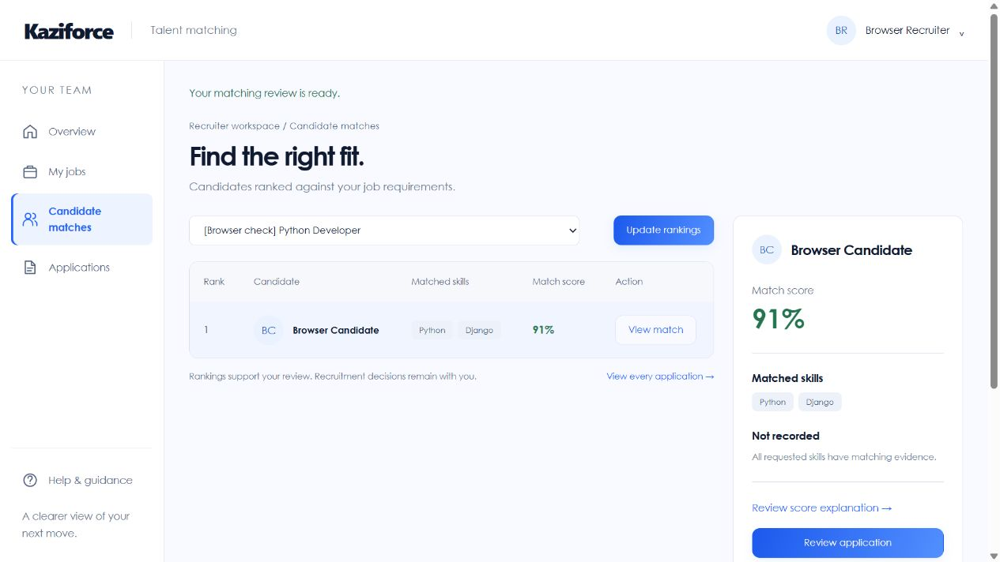
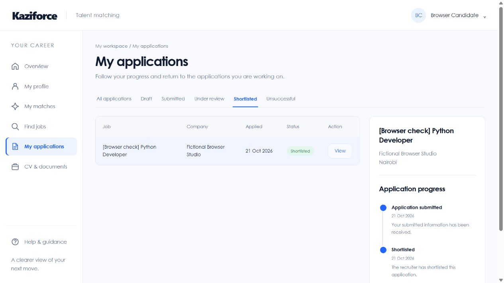

# Browser workflow verification

Date: 21 October 2026. Result: the checked candidate and recruiter flows completed successfully. No application code changes were needed during this pass.

This is the earlier recruitment browser pass. The later [verification follow-up](final-verification.md) records current freelance and administration checks, physical interviews and a completion-action fix. The component breakdown and mapping warnings described below were subsequently replaced on candidate pages with simpler guidance; those earlier observations do not describe the current candidate interface.

This record describes agent-operated browser checks. It does **not** record human participants, user satisfaction or acceptance sign-off. The [human acceptance checklist](user-acceptance.md) remains pending.

## Environment and scope

The installed KaziForce source was copied to a disposable preview with its own SQLite database and private storage. The full local ESCO v1.2.0 reference contained 13,939 concepts. Two fictional accounts were prepared for the checks. Browser actions used the actual forms and navigation in the ChatGPT in-app browser. Development PostgreSQL records, uploaded documents and configuration were not used for test writes.

Desktop views were inspected at 1280 × 720 and mobile views at 390 × 844. The tables and navigation use their own horizontal scrolling where needed; the reviewed mobile pages did not introduce horizontal overflow across the entire page. The review panel stacks below the table at the mobile width.

## Observed workflow results

| Check | Observed result |
| --- | --- |
| Recruiter email sign-in and workspace navigation | Recruiter dashboard and job-management controls opened |
| Create a job and add another skill row | Job saved with Python and Django, qualification and experience requirements |
| Job preview | Title, company, description and skills updated while entering the form |
| Candidate email sign-in | Candidate dashboard showed the correct candidate navigation |
| Manual professional profile | Summary, two skills, education, certification, experience and portfolio saved through the browser |
| Profile section navigation | Entered values remained while switching sections before saving |
| Private document upload | A public project photograph uploaded as a clearly labelled fictional image fixture; the document appeared in the private library |
| Candidate recommendation and explanation | Updating matches produced a saved result, component breakdown and mapping warnings |
| Start and tailor an application | Saved profile fields prefilled the independent application copy |
| Save a private draft | Tailored headline, recruiter message and selected document remained in the draft |
| Recruiter draft privacy | The recruiter's inbox remained empty before submission |
| Submit the application | Submitted detail showed the tailored profile, selected file and submission progress |
| Profile independence | Main profile retained its original headline after tailoring; changing it later left the submitted headline unchanged |
| Recruiter rankings and review panel | Submitted candidate appeared after refresh; the review panel linked to the submitted application |
| Shared document viewing | Owning recruiter opened the submitted image copy in a separate browser tab |
| Update application status | Under review and Shortlisted updates saved successfully |
| Change job requirements | Reducing the Django priority and adding preferred Docker marked saved rankings as out of date |
| Refresh after job edits | Refreshed result showed Docker as missing and changed the displayed score from 91% to 85% |
| Close the job | Job displayed Closed while retaining its submitted applicant |
| Candidate progress and filtering | Shortlisted filter returned the application and its progress panel showed the recruiter's update |
| Keyboard account menu | Enter opened the account menu; Escape closed it |
| Browser diagnostics | No warning or error entries were returned by the final checked tab's collected browser logs |

The image fixture tests upload, selected sharing and inline viewing. It is not a degree, certificate or CV and does not establish document authenticity. PDF/DOCX formats, file signatures, limits and access boundaries are additionally covered by the automated regression suite. Public registration, real inbox delivery and screen-reader operation were not repeated in this browser pass.

## Screenshot evidence

Desktop recruiter review:

Desktop candidate progress after shortlisting:

Mobile screenshots: [recruiter review](browser-evidence/recruiter-ranking-mobile.jpg) and [candidate progress](browser-evidence/candidate-progress-mobile.jpg).

## Remaining acceptance work

Real candidate and recruiter feedback, independent relevance judgements, broader browser/device coverage, screen-reader testing and Gmail delivery verification remain outstanding. No claims of usability scores, accessibility conformance or hiring accuracy follow from this pass. See the [synthetic matching evaluation](evaluation/report.md) for its separate methodology and limitations.
